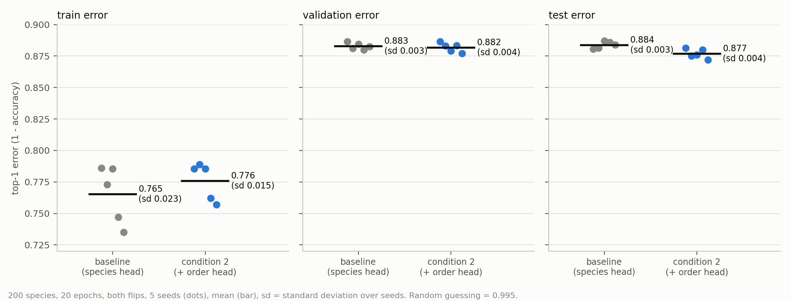
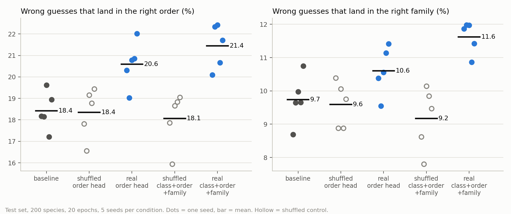

# inat-taxonomy-cnn

PyTorch experiments on the iNaturalist 2021 mini dataset: does telling a small CNN where each species sits in the taxonomy (kingdom, phylum, class, order, family, genus, species) help it?

**Full report: [REPORT.md](REPORT.md)** (also as [REPORT.pdf](REPORT.pdf)). My lab notebook with every number, failure and decision is [NOTES.md](NOTES.md).

## Folders

| folder | what is in it |
|---|---|
| `data_prep/` | scripts that build the `.npz` data files from the downloaded photos |
| `experiments/` | training scripts: `taxo.py` (the two conditions and controls), `softloss.py` (soft labels), `arch.py` (six architectures), `single_level.py` and `single_arch.py` (one network per taxonomy level), `inat_cond2.py`, `cifar_torch.py`, `torch_toy.py` |
| `queues/` | shell scripts that ran the experiments one after another |
| `results/` | the printed output of every run, one file per run |
| `charts/` | scripts that make the figures from `results/`, and `summarize.py` |
| `figures/` | the charts used in the report |

No photos are included. The dataset belongs to iNaturalist and has to be downloaded separately, for non-commercial research use only.

## How to run

Run everything from the repository root, for example `python experiments/taxo.py DATA.npz SEED LEVELS EPOCHS`. The scripts in `data_prep/` build the `.npz` files from the downloaded `train_mini` photos and write them to `~/inat_data`. Section 16 of the report lists every command.
