# Does telling a CNN the taxonomy help? Multi-task and soft-label experiments on iNaturalist 2021 mini

*Simha Teja, 31 October 2026*

**GitHub repository:** <https://github.com/Simhateja17/inat-taxonomy-cnn>

The code, one result file for every run, and all the charts are in this repository. For the full detail, my lab notebook is [`NOTES.md`](https://github.com/Simhateja17/inat-taxonomy-cnn/blob/main/NOTES.md), where I wrote down every number, every failure and every decision I made.

## Contents

1. [The dataset: iNaturalist 2021 mini](#1-the-dataset-inaturalist-2021-mini)
2. [Question, conditions and metrics](#2-question-conditions-and-metrics)
3. [Model and training](#3-model-and-training)
4. [Getting a working baseline](#4-getting-a-working-baseline)
5. [The two conditions on 200 species](#5-the-two-conditions-on-200-species)
6. [Controls: is it the real taxonomy?](#6-controls-is-it-the-real-taxonomy)
7. [Same question with 500 species](#7-same-question-with-500-species)
8. [Soft labels from the taxonomy](#8-soft-labels-from-the-taxonomy)
9. [Architectures and ImageNet pretraining](#9-architectures-and-imagenet-pretraining)
10. [Which levels does a network learn first?](#10-which-levels-does-a-network-learn-first)
11. [All 2,076 species, one network per taxonomy level](#11-all-2076-species-one-network-per-taxonomy-level)
12. [CPU against GPU](#12-cpu-against-gpu)
13. [Conclusions](#13-conclusions)
14. [Limits, failures and uncertainty](#14-limits-failures-and-uncertainty)
15. [Compute and reproducibility checklist](#15-compute-and-reproducibility-checklist)
16. [How to reproduce](#16-how-to-reproduce)

## 1. The dataset: iNaturalist 2021 mini

iNaturalist is a website where volunteers photograph plants, animals and fungi, and the community names the species. The iNaturalist 2021 dataset (Van Horn et al., "Benchmarking Representation Learning for Natural World Image Collections", CVPR 2021) is a collection of these photos. Every photo has a label: its species, and the full path of that species through the tree of life (kingdom, phylum, class, order, family, genus, species). The full dataset has 10,000 species. The "Train Mini" version keeps 50 photos for each species. The photos are taken by volunteers with phones and cameras, so the light, the angle, the distance and the background change from photo to photo.

**The taxonomy path.** The full path of each species is written in the name of its folder. For example, the folder `04798_Animalia_Chordata_Mammalia_Rodentia_Chinchillidae_Lagidium_viscacia` means kingdom Animalia, phylum Chordata, class Mammalia, order Rodentia, family Chinchillidae, genus Lagidium, species Lagidium viscacia. This path is the taxonomy I use: the order head, the class, order and family heads, and the soft labels are all built from it.

**What I downloaded.** I did not use all 10,000 species. I downloaded part of Train Mini: **2,076 complete species, 50 photos each, 103,800 photos**. The photos I checked from one species are about 500 pixels on the longest side. These 2,076 species cover:

| level | number of groups in my 2,076 species |
|---|---|
| kingdom | 3 (Animalia 1,113 species, Plantae 904, Fungi 59) |
| phylum | 11 |
| class | 35 |
| order | 170 |
| family | 539 |
| genus | 1,566 |
| species | 2,076 |

**The subsets I trained on.** I shrank every photo to a small square (squashed, not cropped), because small photos train fast on one laptop.

| name | species | photos | size of each photo | how I picked it |
|---|---|---|---|---|
| 200-species set | 200 | 10,000 | 64x64 | 20 random orders (out of the 46 orders with at least 10 species), then 10 random species from each, seed 42 |
| 500-species set | 500 | 25,000 | 64x64 | 25 orders x 20 species |
| 2,076-species set | 2,076 | 103,800 | 32x32 | all the species I downloaded (32x32 so I could compare it with CIFAR-10) |

**Train, validation and test split.** For every species, by position in its folder: the first 30 photos go to training, the next 10 to validation and the last 10 to test.

| set | 200 species | 2,076 species |
|---|---|---|
| training | 6,000 | 62,280 |
| validation | 2,000 | 20,760 |
| test | 2,000 | 20,760 |

**Rules I follow.** The photos belong to the iNaturalist community and the dataset is for non-commercial research. I use the photos only for this research, I did not scrape any extra photos, and I do not put any photo in the code repository, this report or the charts. Anyone who wants to repeat the experiments has to download the dataset themselves.

## 2. Question, conditions and metrics

**The question.** I wanted to know: if I also tell a small CNN where each species sits in the tree of labels (section 1), (1) does it name the right species more often, and (2) when it is wrong, is its wrong guess at least in the right group, meaning the same class, order or family as the true species?

**The two conditions.** This is the main comparison, on 200 species:

- **Condition 1, baseline:** a small CNN that only predicts the species.
- **Condition 2:** the same CNN with one extra output that predicts the order. The loss is species loss plus order loss, so the order loss also trains the shared layers.

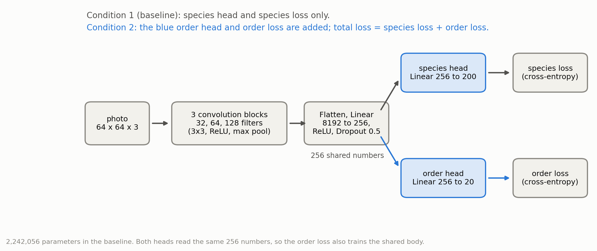

**How I measure it.** I report top-1 and top-5 accuracy as error (1 - accuracy) on train, validation and test. I also track a second thing, which I call mistake quality: of the wrong species guesses, the share that still fall in the right class, order or family. A higher share means better mistakes. For reference, a random wrong guess among the other 199 species lands in the right order only 9/199 = 4.5% of the time.

**My rule for the test set.** I picked every setting on validation. Test accuracy was printed during training, but I never used it to choose a setting.

### Experiments at a glance

| # | Experiment | Data | Seeds | Epochs | Main finding |
|---|---|---|---|---|---|
| 1 | Tuning the baseline | 200 species, 64x64 | 5 | 20 or 50 | best setting: both flips, 20 epochs; 50 epochs gave no clear gain in validation accuracy |
| 2 | **Condition 1 vs condition 2** | 200 species | 5 | 20 | order head: more wrong guesses fall in the right order (20.6% against 18.4%) |
| 3 | Shuffled-group controls | 200 species | 5 | 20 | shuffled groups give no gain: same right-order share as the baseline (18.4%) |
| 4 | Order head, 500 species | 500 species | 3 | 30 | same result as with 200 species: more wrong guesses fall in the right order (21.9% against 19.7%) |
| 5 | Soft labels from the taxonomy | 200 species | 5 | 20 | a lower beta puts more wrong guesses in the right order but lowers top-1 accuracy |
| 6 | Six architectures | 200 species | 5 | 20 | ImageNet pretraining more than doubles test accuracy; more parameters did not raise it |
| 7 | Learning order of the levels | 200 species | 5 | 20 | accuracy at every level rises together during training, with no coarse-first stages |
| 8 | One network per taxonomy level | 2,076 species, 32x32 | 1 to 3 | 8 to 30 | test accuracy of our CNN drops steeply from class (0.62) to order (0.28) |
| 9 | CPU against GPU | 200 and 400 species | 1 | 15 | GPU 2 times faster, no clear accuracy difference |

## 3. Model and training

- **Baseline model** (diagram in section 2): three convolution blocks (32, 64, 128 filters, 3x3, ReLU, max pool), then Linear(8192, 256), ReLU, Dropout 0.5, Linear(256, 200). 2,242,056 parameters.
- **Training:** pixels centred with (x - 0.5) / 0.25, NAdam, learning rate 0.0003, batch size 32, random left-right and up-down flips, cross-entropy loss.

## 4. Getting a working baseline

My first baseline didn't learn anything. Validation sat at 0.005, which is chance (a random guess among 200 species is right 1 time in 200 = 0.005), for every single epoch. There turned out to be two separate problems, and I only found the first one by actually looking at the data:

1. A loading bug. I wrote `picked[0]` instead of `name`, so all 200 species got the same 50 photos. I caught it by counting distinct photos: 50 instead of 10,000.
2. Even after that fix, the model was still stuck at learning rate 0.001. NAdam with 0.0003 learned. Centring the pixels made training faster, but it wasn't the real fix.

One more thing that cost me time: on the Apple GPU, the tensor has to be made `.contiguous()` after `permute` before training. Same code, same seed: validation was 0.022 without it and 0.079 with it.

### Tuning (5 seeds each, validation top-1)

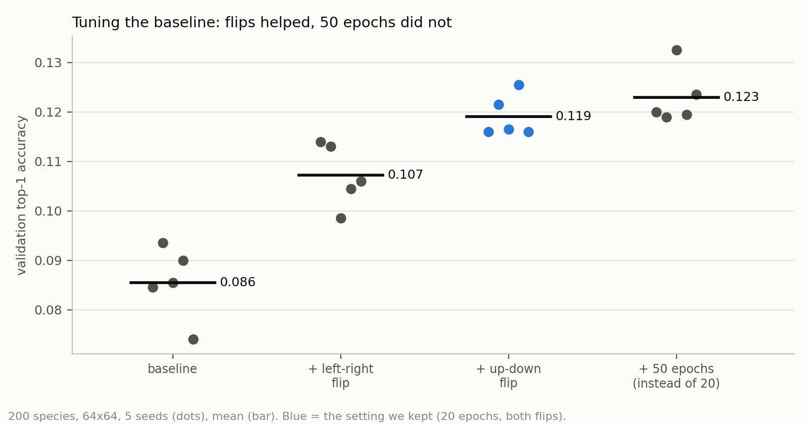

**What this shows:** the two flips raised validation top-1 from 0.0855 to 0.1191. Going from 20 to 50 epochs raised it only from 0.1191 to 0.1229.

| setting | validation top-1 mean |
|---|---|
| no flip, 20 epochs | 0.0855 |
| + random left-right flip | 0.1072 |
| + random up-down flip too | 0.1191 |
| + 50 epochs instead of 20 | 0.1229 |

50 epochs took 2.5 times longer and gained 0.004, which is inside the seed noise (the run-to-run variation I get when I repeat the same setting with a different random seed, about 0.004 to 0.015 here). Not worth it. So I kept **both flips and 20 epochs** for every final run.

### More photos, more species

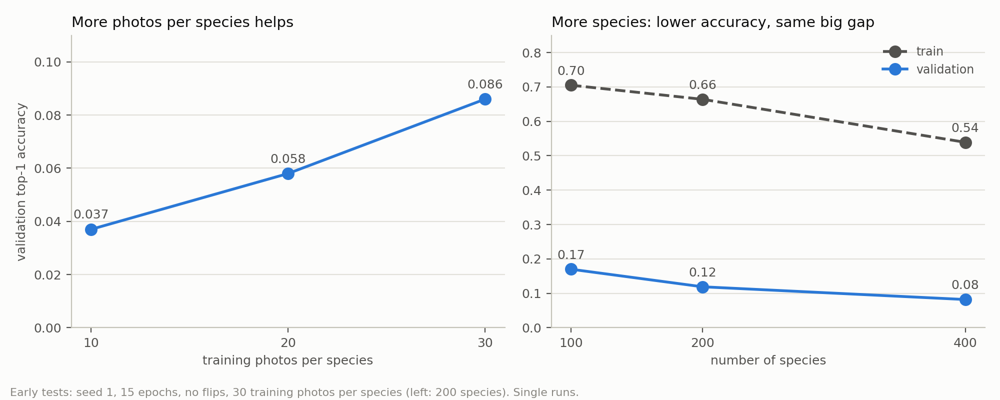

**What this shows:** more training photos per species help (10 / 20 / 30 photos: 0.037 / 0.058 / 0.086). More species make the task harder (100 / 200 / 400 species: 0.170 / 0.119 / 0.082), and the gap between train and validation stays near 0.5. Keep in mind these early tests are single runs without flips.

## 5. The two conditions on 200 species

Now that the baseline learns and its settings are chosen, I can ask the main question. Final settings: both flips, 20 epochs, 5 seeds (1 to 5), same data, same splits. Numbers are mean ± standard deviation over the 5 seeds. I measure train error on a subset of the training photos in evaluation mode.

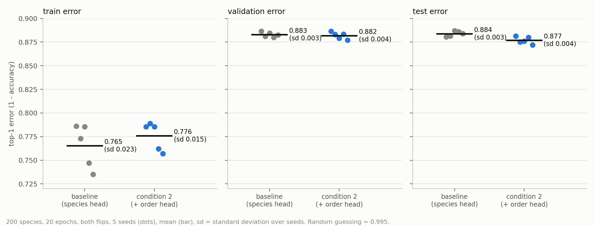

**What this shows:** all three panels share the same scale. On train and validation the two conditions are almost the same. On test, the error of condition 2 is 0.877 against 0.884 for the baseline, a difference of 0.007.

| condition | train error | validation error | test error | test top-5 accuracy |
|---|---|---|---|---|
| 1. baseline (species head) | 0.765 ± 0.023 | 0.883 ± 0.003 | 0.884 ± 0.003 | 0.2967 |
| 2. + order head | 0.776 ± 0.015 | 0.882 ± 0.004 | 0.877 ± 0.004 | 0.3098 |

Random guessing has an error of 0.995.

**How I read this.** On validation, the two are identical (0.883 and 0.882). On test, the error of condition 2 is 0.007 lower. The standard error of that difference is 0.0021, so a t-test over the 5 seeds gives t = 3.2 (p about 0.01). A test that pairs the seeds by number gives t = 3.0 (p about 0.04), although the seeds are matched by number only and are not truly paired. So the test difference is unlikely to be seed noise. But validation shows no difference at all (0.883 and 0.882), and I used one data split. So I report a small test gain of 0.007 in species accuracy, and I do not claim that the order head improves species accuracy in general.

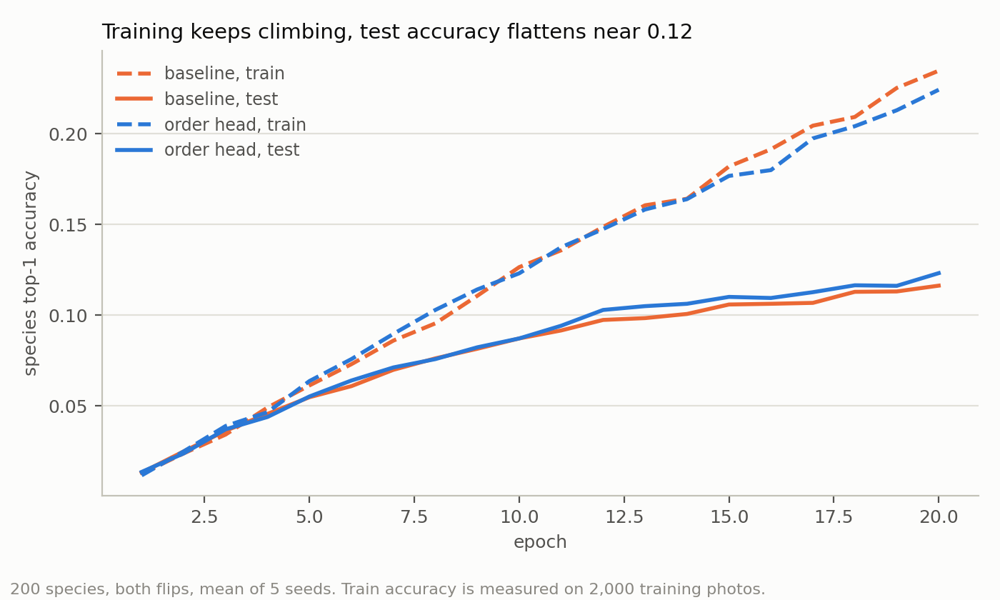

**What this shows:** train accuracy keeps climbing during the 20 epochs while test accuracy levels off. Overfitting means the train accuracy is far above the test accuracy. Both conditions do this: train accuracy is about 0.23, test accuracy about 0.12.

### Mistake quality

Here the order head changes how the model is wrong. The number of wrong species guesses is about the same, but more of them fall in the right order.

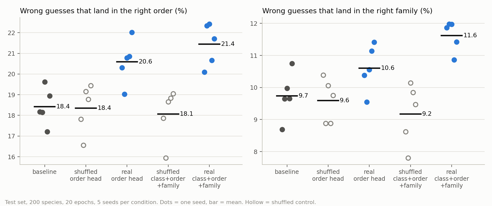

**What this shows:** the share of wrong test guesses that still land in the right group. One dot per seed.

| condition | right class | right order | right family |
|---|---|---|---|
| baseline | 46.5% | 18.4% | 9.7% |
| + order head | 49.1% | 20.6% | 10.6% |
| + class, order, family heads | 50.3% | 21.4% | 11.6% |

Before I merged everything into one script (`taxo.py`), my earlier scripts gave the same picture on the test set: 18.3% for the baseline and 20.4% for the order head.

## 6. Controls: is it the real taxonomy?

There's an obvious objection here. Maybe the extra head helps just because it's an extra task, and extra tasks act as a regulariser (anything that stops the network from fitting the training photos too closely). Nothing to do with the taxonomy.

To check this, I built a control. The extra head keeps the same group sizes (10 species per order, and so on), but I assign species to groups at random. I still measure mistake quality with the real taxonomy.

| condition | right class | right order | right family |
|---|---|---|---|
| baseline | 46.5% | 18.4% | 9.7% |
| real order head | 49.1% | 20.6% | 10.6% |
| **shuffled** order head | 46.6% | 18.4% | 9.6% |
| real class, order, family heads | 50.3% | 21.4% | 11.6% |
| **shuffled** class, order, family heads | 45.8% | 18.1% | 9.2% |

The shuffled heads land right back on the baseline. So the improvement doesn't come from having an extra head. It comes from the real structure. For the three-head model, the seed ranges of real and shuffled don't overlap at class, order or family. For the order head alone they touch slightly (19.0% against 19.4% at order), so that one comparison is weaker.

Shuffled groups were also slightly worse on species accuracy (test top-1 0.1106 against 0.1162 for the baseline). The ranges overlap, though, so I'd only call this a hint that wrong groups confuse the network.

## 7. Same question with 500 species

I wanted to see if the result holds up on a bigger set.

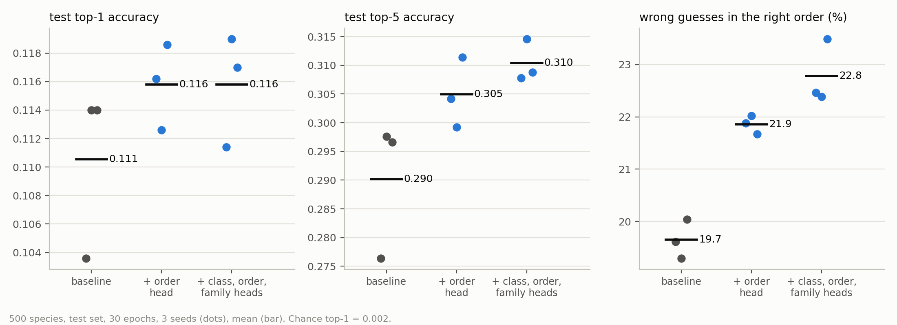

**What this shows:** same ranking as with 200 species. 500 species (25 orders x 20), 30 epochs, 3 seeds, test set:

| condition | train error | validation error | test error | test top-5 accuracy | right order |
|---|---|---|---|---|---|
| baseline | 0.692 | 0.889 | 0.890 | 0.290 | 19.7% |
| + order head | 0.684 | 0.881 | 0.884 | 0.305 | 21.9% |
| + class, order, family heads | 0.726 | 0.883 | 0.884 | 0.310 | 22.8% |

The seed ranges for right order don't overlap. Top-5 accuracy also goes up with the extra heads (the ranges just separate). Top-1 ranges overlap. With only 3 seeds, I do not claim it is established: it is a first result that needs more seeds.

## 8. Soft labels from the taxonomy

The extra head is one way to use the taxonomy. There's another that needs no extra head at all: change the target. Instead of a one-hot target, I give every species a soft weight. For a photo of species A, species B gets a weight that drops with the tree distance between them: exp(-beta * d / 7), where d is 1 plus the number of levels (genus up to kingdom) at which they differ. A bigger beta pushes the target closer to one-hot. The idea comes from "Making Better Mistakes".

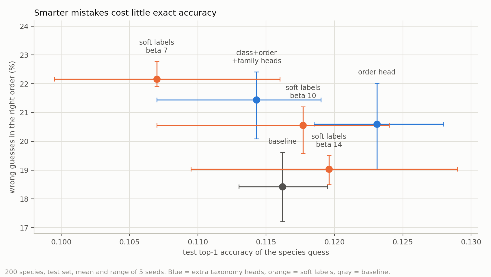

**What this shows:** each dot is one method (mean and range of 5 seeds). Soft labels with a low beta and the three-head model both reach the highest right-order share. The price is lower top-1 accuracy: 0.1070 at beta 7 against 0.1162 for the baseline.

| setting | test error | test top-5 accuracy | right order | right family |
|---|---|---|---|---|
| baseline (one-hot) | 0.884 | 0.297 | 18.4% | 9.7% |
| soft labels, beta 14 | 0.880 | 0.305 | 19.0% | 10.1% |
| soft labels, beta 10 | 0.882 | 0.311 | 20.6% | 10.6% |
| soft labels, beta 7 | 0.893 | 0.293 | 22.2% | 11.8% |

At beta 7, the mistakes are as good as the three-head model (22.2% against 21.4% right order) without any extra head. But test top-1 drops to 0.1070. So beta sets a trade: a lower beta gives more wrong guesses in the right order but a lower top-1 accuracy, and a higher beta does the reverse. Beta 10 is the middle ground.

## 9. Architectures and ImageNet pretraining

Next I asked whether a different network would do better. 200 species, 20 epochs, 5 seeds, species head only.

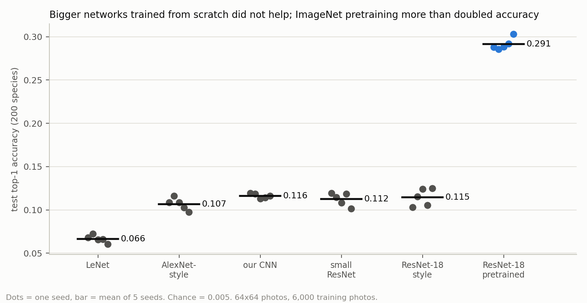

**What this shows:** one dot per seed. From scratch, only LeNet is clearly worse. The pretrained network reaches 0.291, the others reach at most 0.116.

| network | parameters | train error | validation error | test error | test top-1 accuracy |
|---|---|---|---|---|---|
| LeNet | 354,636 | 0.888 | 0.939 | 0.934 | 0.0665 |
| AlexNet-style | 8,248,136 | 0.828 | 0.907 | 0.893 | 0.1066 |
| our CNN (baseline) | 2,242,056 | 0.765 | 0.883 | 0.884 | 0.1162 |
| small ResNet | 1,277,800 | 0.839 | 0.889 | 0.888 | 0.1124 |
| ResNet-18 style, from scratch | 11,271,432 | 0.739 | 0.890 | 0.885 | 0.1146 |
| ResNet-18, ImageNet pretrained | 11,279,112 | 0.148 | 0.713 | 0.709 | 0.2914 |

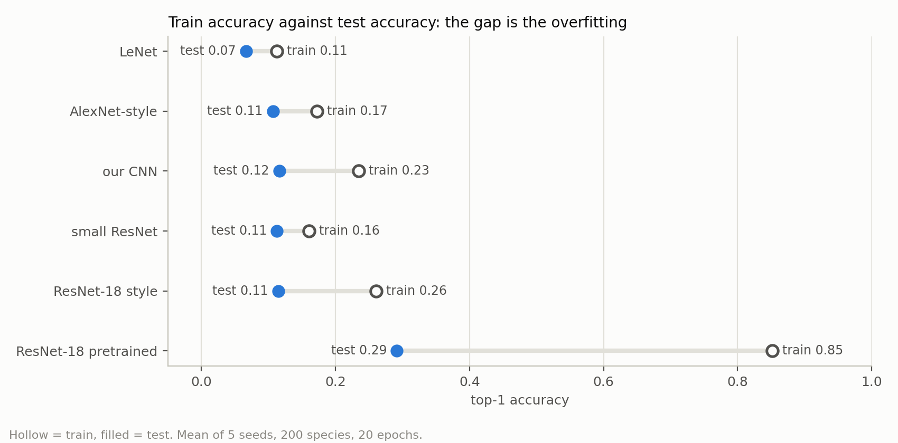

**What this shows:** the gap between the hollow dot (train) and the filled dot (test) is the overfitting. Every network overfits. The pretrained one has the largest gap (train accuracy 0.852, test accuracy 0.291, a gap of 0.56), and my baseline has a gap of about 0.12 (0.235 against 0.116).

- LeNet (two small convolution layers) is the only one that's clearly worse. Its train error (0.888) is almost as high as its test error (0.934), so it is too small to fit even the training photos. This is called underfitting.
- Between 1.3 million and 11.3 million parameters, trained from scratch on 6,000 photos, nothing beats my 2.2-million-parameter baseline. More parameters did not raise the test accuracy here.
- Pretraining more than doubles top-1 (0.291 against 0.116) and top-5 (0.558 against 0.297), and more of its wrong guesses are in the right group too (right order 29.5%, right family 16.3%). Its validation accuracy peaks around epoch 10 and then falls, so training for fewer epochs might help. I did not test that.
- To be fair to the others: the pretrained network brings knowledge from 1.2 million ImageNet photos, so I treat it as a separate experiment. Its input photos were doubled in size to 128x128 inside the model, and the last layer is new and random.

## 10. Which levels does a network learn first?

Section 9 compared the networks by their species accuracy. I also wanted to see how each network learns the other levels of the tree while it trains.

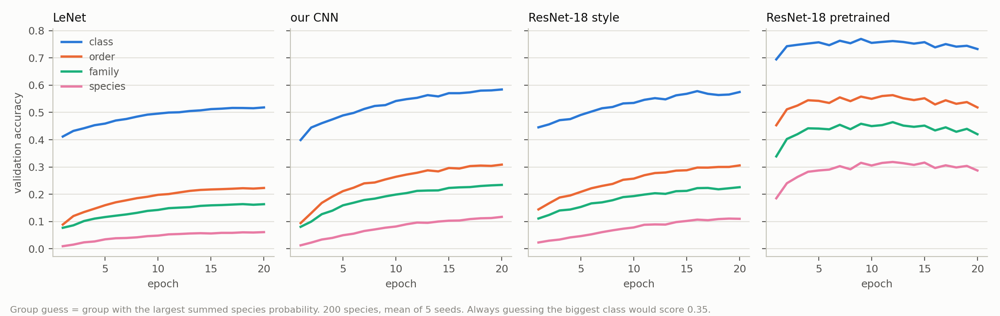

**What this shows:** validation accuracy per epoch at class, order, family and species level. For each level I take the group with the largest summed species probability (mean of 5 seeds).

My guess going in was that a network might learn the broad differences first and the fine ones later. That's not what I saw. Coarse groups are always more accurate than fine ones, in every model, but all levels rise together, smoothly. No stage-like jumps, and no clear difference between the shallow LeNet and the deeper nets. The pretrained network already knows all levels after the first epoch.

## 11. All 2,076 species, one network per taxonomy level

Everything so far used at most 500 species. For the last big experiment I wanted to see how accuracy changes as the question gets finer, so I used the 2,076-species set (section 1). I trained a separate network for each level, from kingdom (3 groups) all the way down to species (2,076 groups).

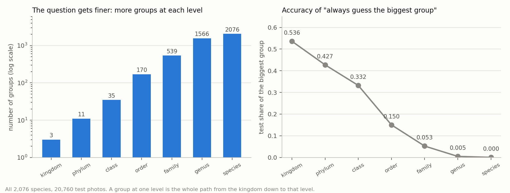

**What this shows:** the number of groups grows from 3 to 2,076, and the "always guess the biggest group" baseline falls from 0.536 (kingdom) to 0.0005 (species).

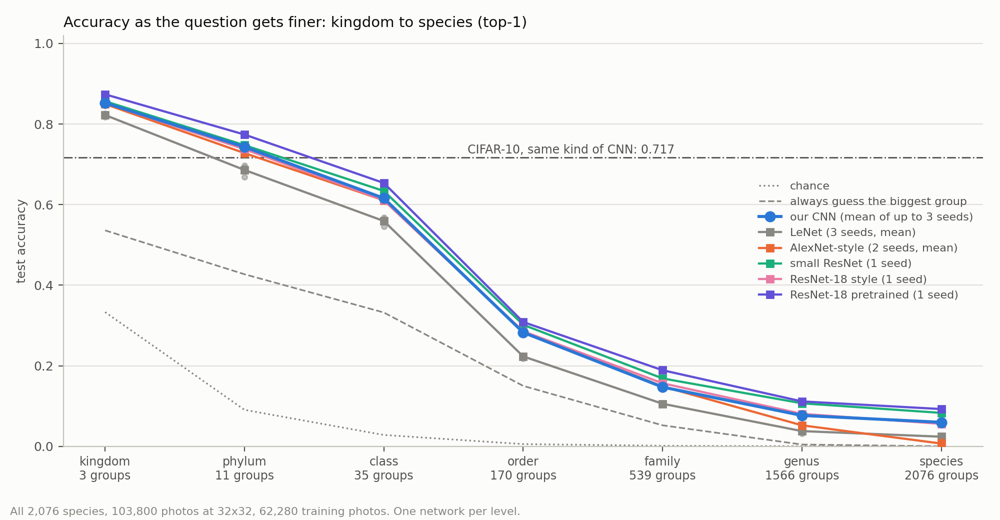

**What this shows:** test top-1 accuracy at each level. For reference I've added chance, the biggest-group guess, and my CNN on CIFAR-10 at the same 32x32 size (0.717 on 10 classes). Dots are single seeds, lines are the mean.

Test top-1 accuracy, mean over seeds (our CNN and LeNet 3 seeds, AlexNet-style 2 seeds, the others 1 seed):

| network | kingdom | phylum | class | order | family | genus | species |
|---|---|---|---|---|---|---|---|
| our CNN | 0.852 | 0.743 | 0.616 | 0.283 | 0.147 | 0.077 | 0.060 |
| LeNet | 0.822 | 0.686 | 0.559 | 0.223 | 0.106 | 0.038 | 0.024 |
| AlexNet-style | 0.849 | 0.728 | 0.611 | 0.285 | 0.149 | 0.053 | 0.007 |
| small ResNet | 0.857 | 0.747 | 0.634 | 0.302 | 0.169 | 0.107 | 0.083 |
| ResNet-18 style | 0.852 | 0.738 | 0.611 | 0.286 | 0.157 | 0.081 | 0.056 |
| ResNet-18 pretrained | 0.874 | 0.774 | 0.654 | 0.309 | 0.189 | 0.112 | 0.093 |

- My CNN's three seeds agree closely (species 0.059 to 0.062), so that line is stable.
- The big drop is between class (0.62) and order (0.28). For a sense of scale: choosing between 11 phyla (0.743) is about as accurate as the same kind of CNN choosing between the 10 CIFAR-10 classes (0.717). They're different tasks, though, so this is only a rough comparison.
- Pretrained ResNet-18 is highest at every level, the small ResNet is second, and LeNet is lowest. From class downward, the small ResNet's gains fall outside my CNN's three-seed range, but it only has one seed.
- The AlexNet-style value of 0.007 at species hides two very different runs. Seed 1 collapsed and predicted one species for every photo (test 0.0005, chance). Seed 2 just learned slowly (0.0140).

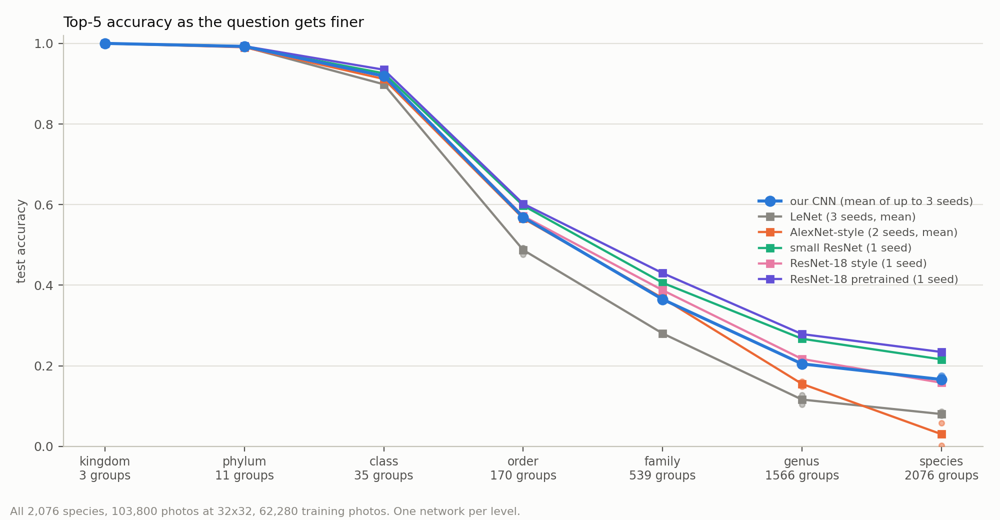

**What this shows:** the same thing for top-5 accuracy.

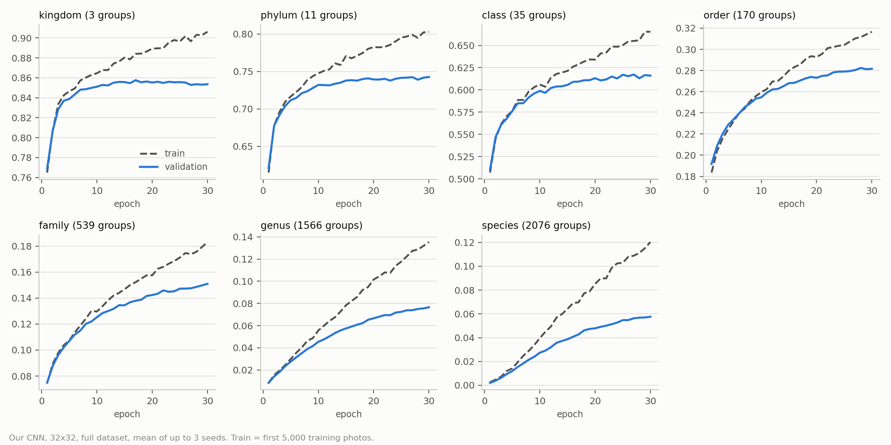

**What this shows:** the coarse levels stop improving early (kingdom validation peaks near epoch 15) while train accuracy keeps going up. The fine levels were still improving at epoch 30, so training longer would probably raise the species numbers. I did not test that.

Parameters (kingdom output / species output): LeNet 61,411 / 237,616; our CNN 618,563 / 1,151,324; small ResNet 1,227,171 / 1,759,932; AlexNet-style 3,428,483 / 4,491,932; ResNet-18 style 11,170,371 / 12,233,820; ResNet-18 pretrained 11,178,051 / 12,241,500. I fixed the epochs in advance and didn't tune them on the test set: 30 for our CNN, LeNet and AlexNet-style, 20 for the small ResNet, 15 for ResNet-18 style, 8 for the pretrained network. That means the networks did not get equal training budgets.

## 12. CPU against GPU

One practical question came up along the way: does it matter whether I train on the CPU or the GPU?

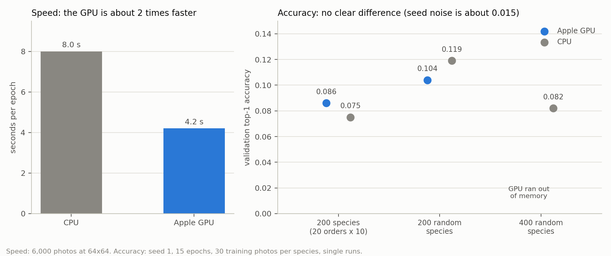

**What this shows:** one epoch on 6,000 photos at 64x64 takes 8.0 s on the CPU and 4.2 s on the Apple GPU. In the two tests where both devices ran, the GPU was higher by 0.011 in one and the CPU higher by 0.015 in the other (the third test ran out of GPU memory), and these differences are no larger than the seed noise, so I see no evidence that the device changes accuracy. These are single runs.

## 13. Conclusions

1. **The taxonomy changes how the model is wrong, and gives at most a small gain in how often it is right.** (Test error 0.877 against 0.884, see conclusion 2.) An order head raises the share of wrong guesses that land in the right order (18.4% to 20.6%), and class, order and family heads push it further (21.4%). The shuffled-group control gives back the baseline value, so the effect really needs the true taxonomy. It shows up again with 500 species, and again with a completely different method (soft labels).
2. **The order head gives a small test gain in species accuracy, which I cannot confirm.** Test error is 0.877 against 0.884 (t = 3.2 over 5 seeds, p about 0.01), but validation shows no gain and I used one data split.
3. **With a small training set, pretraining gave by far the largest gain in test accuracy** (0.291 against 0.116), much larger than any change in depth or parameter count.
4. **The finer the question, the harder it gets.** On all 2,076 species, accuracy falls from 0.85 (kingdom) to 0.06 (species), and the steepest drop is between class and order.
5. **All levels are learned together.** I found no coarse-first stages.

## 14. Limits, failures and uncertainty

I want to be upfront about what this work can and can't show.

### Limits of the evidence

- **One data split per experiment.** Seeds change the starting weights and the order of the photos in each batch, but not which photos are in train, validation and test. I did not measure how much the results change with a different split.
- **Few seeds.** 5 for the 200-species experiments, 3 for 500 species and for our CNN and LeNet on the full set, and 1 (2 for AlexNet-style) for the other networks on the full set. That is not enough to rank the networks that are close together (our CNN, ResNet-18 style, AlexNet-style, small ResNet).
- **Single runs.** The data-amount tests and the CPU against GPU test are single runs.
- **Taxonomy shape.** The 200-species set has exactly 10 species in each of 20 orders. A different mix of orders might give different results.
- **Resolution and training length.** The 200 and 500-species sets use 64x64 photos, and the full set uses 32x32. Higher resolution, more training photos and longer training would probably raise every number, but I did not test this. Species accuracy from scratch is low in absolute terms (0.06 to 0.12).
- **AlexNet-style collapse.** At species level on the full set, one of its two seeds collapsed (section 11).

### Mistakes I made and how I fixed them

Full details are in `NOTES.md`.

1. **Photo-loading bug.** All 200 species got the same 50 photos. I fixed the loading code (section 4).
2. **A single `=` instead of `==`.** A check printed "88.8% right order", which was meaningless. I fixed the comparison.
3. **Wrong labels in a comparison.** I compared the predicted order with the true species instead of the true order, so the order accuracy was wrong. I fixed the labels.
4. **`.contiguous()` on the GPU.** Without it, validation accuracy was 0.022 instead of 0.079 for the same code and seed (section 4).
5. **GPU out-of-memory error in AlexNet-style runs at family and genus level.** It was not a real lack of memory. The training loop queued about 1,950 GPU steps per epoch without waiting. Adding a wait every 100 steps removed the error and changed no number. I tested only that the fix works, not that this was the cause.

### What I did not try

- other taxonomy levels as extra heads on the full set;
- a location prior;
- placing unseen species in the tree;
- more seeds with several data splits.

## 15. Compute and reproducibility checklist

| item | status |
|---|---|
| Hardware | MacBook with Apple M5 and 16 GB shared memory, PyTorch 2.8.0 (Apple GPU backend "mps"), torchvision 0.23.0, Python 3.9 |
| Time | about 4 s per epoch on 6,000 photos at 64x64; about 8 s per epoch for our CNN on the full 32x32 set. One full-set level took about 7 minutes (small ResNet), 17 (ResNet-18 style), 19 (AlexNet-style), 11 (pretrained ResNet-18) |
| Runs | 156 result files, one per run, in `results/`, named experiment_setting_seed (for example `taxo200_order_s1.txt` is the order head on 200 species, seed 1): `taxo200` 25, `taxo500` 9, `soft200` 15, `arch200` 30, `all32` 77 |
| Seeds | fixed per run; the same seed gives identical output (checked) |
| Number of seeds | stated for every table and chart |
| Reported statistic | mean over seeds, with standard deviation or range, never the best seed |
| Splits | 30 / 10 / 10 photos per species, by position, the same for all experiments |
| Test set | test accuracy was printed during training, but no setting was chosen from it; all settings were chosen on validation |
| Hyperparameters | listed in section 3; epochs per network stated in sections 4, 7, 9 and 11 |
| Negative and unclear results | included (50 epochs, species gain, AlexNet collapse, CPU vs GPU) |
| Controls | shuffled-group controls for the extra heads |
| Data | no photos in the repository; download from iNaturalist |

## 16. How to reproduce

Run everything from the repository root. The photos aren't included, so start by getting them.

1. Download iNat 2021 mini "Train Mini" and point `data_prep/inat_pick.py`, `data_prep/inat_pick500.py` and `data_prep/inat_pick_all32.py` to it. They write the `.npz` files into `~/inat_data`.
2. 200 species: `python experiments/taxo.py ~/inat_data/inat200_64.npz SEED none 20` (baseline) and `... SEED order 20` (order head). Add `shuffle` for the control.
3. Architectures: `python experiments/arch.py DATA SEED ARCH EPOCHS`. Soft labels: `python experiments/softloss.py DATA SEED BETA EPOCHS`.
4. Full set: `python experiments/single_level.py DATA SEED LEVEL EPOCHS` (our CNN) and `python experiments/single_arch.py DATA SEED LEVEL EPOCHS ARCH` (other networks).
5. Summaries: `python charts/summarize.py PREFIX CONFIG...`. Charts: `charts/make_charts*.py`.

The printed output of every run is saved in `results/`.